# KnowFab SIRP · 知造

**让设备数据直接驱动业务，而不是让工人重复录入。**

KnowFab SIRP is a **free, open-source, device-native factory ERP (AI+)** for small and midsize
manufacturers. It turns shop-floor machine data into business documents:
**PLC / OPC UA acquisition → line counting → automatic finished-goods receipt → purchase & sales
orders and stock documents → AR/AP with aging → business reports and AI analysis** —
an end-to-end loop across **production, business and data**.

- **Production and business in one loop** — machine counts post finished goods into stock directly;
  output *is* inventory, no manual scanning.
- **Business and finance in one loop** — shipments create receivables, goods receipts create payables;
  payment matching and aging analysis share the same ledger source.
- **Data never leaves the plant** — single installer with a bundled database, works offline, AGPL-3.0.

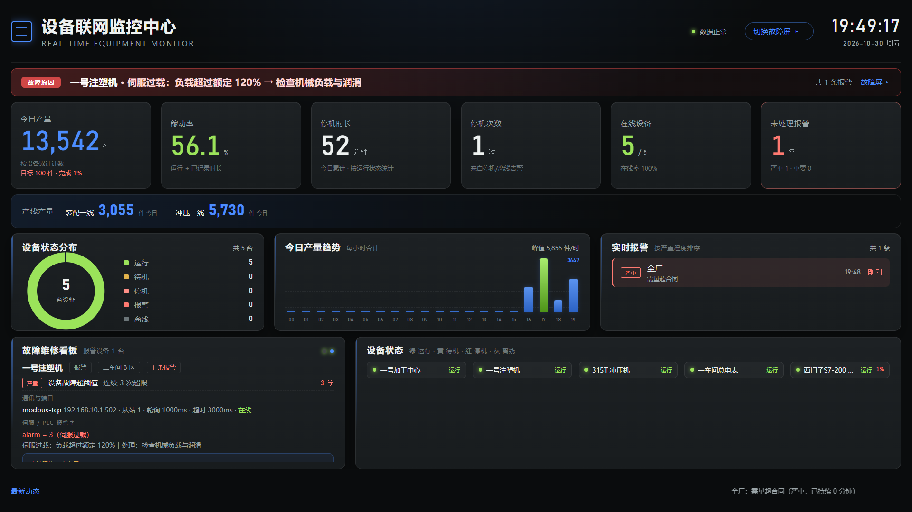

The shop-floor board shows output, running state, alarms and energy at a glance — refreshed every
5 seconds, viewable from a phone too. Both new and legacy machines connect (Modbus TCP / RTU,
OPC UA, RS-485), it works offline, and data never leaves your plant. AGPL-3.0.

**One command to install** (target machine needs no Java, database or Docker preinstalled):

```bash
# Linux / macOS
curl -fsSL https://gitee.com/ZhuangRenyang/KnowFab-SIRP/raw/main/tools/portable/install.sh | bash
```

```powershell
# Windows（管理员 PowerShell）
irm https://gitee.com/ZhuangRenyang/KnowFab-SIRP/raw/main/tools/portable/install.ps1 | iex
```

装完浏览器打开 `http://localhost:8080`，默认账号 `admin` / `123456`（首次登录请改密码）。

[简体中文完整文档](README.zh-CN.md) · [日本語](README.ja.md) · [한국어](README.ko.md) · [Español](README.es.md) · [Deutsch](README.de.md) · [Русский](README.ru.md)

---

<a id="english"></a>

## English

### AI-powered Smart Factory Management System

[](LICENSE)
[](https://github.com/ZhuangRenyang/KnowFab-SIRP/releases)
[](https://adoptium.net/)

**Let the machines report their own output — instead of asking workers to scan barcodes.**
Device-level data acquisition → finished-goods counting per line → automatic stock-in → purchasing /
inventory / sales / finance in one ledger → business reports → an AI assistant for the whole team.
It runs on **your own server**. Java 17 + Spring Boot 3 + Vue 3 + MySQL / MariaDB, shipped as a single jar —
or use the **self-contained portable build** that bundles Java and the database, so a bare machine
can start it with one command.

**Four traits, all grown on the shop floor** (not features invented at a desk):

- **One command, zero prerequisites.** Bundled Java 17 + MariaDB; a single line on Windows or Linux.
  No Docker, no pre-installed database, and the browser opens by itself. Everything lives in one
  directory — **copy it as a backup, delete it to uninstall**.
- **Old machines can count too.** Four wiring paths: Ethernet Modbus TCP, **OPC UA** (most new PLCs
  ship it, e.g. S7-1500 / Inovance / Omron NX), RS-485 pass-through, and relay + limit-switch
  pulse counting. A twenty-year-old press with no network port still gets one
  count per part.
- **Output becomes inventory automatically.** Every count posts into finished-goods stock — nobody
  scans anything. Purchasing / inventory / sales / finance share one ledger, so "the books don't
  match the warehouse" cannot happen by construction.
- **Upgrades never migrate data.** System page → *Check for updates* → download + signature check →
  swap the jar. The database stays untouched. Self-hosted, so data never leaves the plant.

---

## Install

Three options — **① is the recommended one**: nothing to install on the target machine, a single
command, roughly 3–5 minutes on first run (it downloads the JRE and the database; later starts are
instant). ② and ③ are for machines that already have a server or a database.

### ① Zero-dependency (recommended): one command, no Java / no database / no Docker

> The portable build bundles a **MariaDB 11.4** instance (MySQL protocol compatible) on its own
> port **3307**, so it never touches a MySQL already running on 3306. Path ③ below is for
> machines that already have MySQL 8 — the app connects to either one.

**Windows** (10 or later):

```powershell
# China (Gitee, recommended)
powershell -ExecutionPolicy Bypass -Command "irm https://gitee.com/ZhuangRenyang/KnowFab-SIRP/raw/main/tools/portable/install.ps1 | iex"

# Global / fallback (GitHub)
powershell -ExecutionPolicy Bypass -Command "irm https://raw.githubusercontent.com/ZhuangRenyang/KnowFab-SIRP/main/tools/portable/install.ps1 | iex"
```

**Linux / macOS (Intel)**:

```bash
# China (Gitee, recommended)
curl -fsSL https://gitee.com/ZhuangRenyang/KnowFab-SIRP/raw/main/tools/portable/install.sh | bash

# Global / fallback (GitHub)
curl -fsSL https://raw.githubusercontent.com/ZhuangRenyang/KnowFab-SIRP/main/tools/portable/install.sh | bash
```

When it finishes, `http://localhost:8080/app/` opens automatically. **Default login is `admin` / `123456`**
(change it after first login under System → Users; override the default with `system.admin.password` in
`config/application.yml` before first start if you need a stronger one).

The first run downloads **JRE 17 + MariaDB 11.4 (portable)** — about 130 MB from Chinese mirrors —
and every start after that takes seconds:

| | |
|---|---|
| Database | `127.0.0.1:3307` — dedicated port, **never touches an existing MySQL on 3306** |
| Where data lives | Inside the install directory (`runtime/data`) — **copy = backup, delete = uninstall** |
| Change the port | `start.bat -Port 9000` / `PORT=9000 ./start.sh` |
| Stop it | `stop.bat` / `./stop.sh` |

Prefer no command line? Grab `device-hub-<version>-portable.zip` from
[Gitee](https://gitee.com/ZhuangRenyang/KnowFab-SIRP/releases) or
[GitHub](https://github.com/ZhuangRenyang/KnowFab-SIRP/releases) → unzip → double-click `start.bat`
on Windows, or run `./start.sh` on Linux.

> **Fully offline shop-floor PC**: run it once on a connected machine (so it fetches `runtime/jre`
> and `runtime/mariadb`), then copy the whole folder over — no further network access needed.
> Already downloaded the zip? Point the installer at the local file:
> `KNOWFAB_PORTABLE_URL=D:\Downloads\device-hub-1.0.1-portable.zip` (`set` the same env var on Windows).
> First start ships with demo data (4 devices, energy and report curves), so you can click around
> without any real hardware.

> The installer looks for the package on **Gitee first, then GitHub** (identical packages). It also
> honours `KNOWFAB_DIR` — default `%LOCALAPPDATA%\KnowFabSIRP` on Windows, `~/KnowFabSIRP` on Linux.

### ② Docker Compose (Linux server, least effort)

```bash
git clone https://github.com/ZhuangRenyang/KnowFab-SIRP.git
cd KnowFab-SIRP
sudo bash deploy.sh        # in China: sudo bash deploy-cn.sh
```

The script generates a random database password, starts the containers, creates the schema, and
prints the access URL plus the initial password.

### ③ A machine that already has MySQL 8 and Java 17

```bash
sudo bash install.sh --db-pass 'your-mysql-password'
```

Installs to `/opt/device-hub` and registers a systemd service. Use `sudo PORT=9000 ./install.sh ...`
to change the port, or `--db pg` for PostgreSQL. You can also skip the script and run
`java -jar device-hub.jar` directly (database password via `DEVICEHUB_DB_PASSWORD`, or change it
later on the System page).

---

**Whichever path you take, the first thing to do afterwards**: open `http://<host>:8080/app/` and
**change the initial password** (top right).

## What problem it solves

Small and mid-sized factories trying to get output, inventory and energy under control usually hit
three walls:

1. **Legacy machines have no network port** — only relays and a buzzer; MES vendors say "replace the
   PLC first".
2. **Barcode reporting depends on discipline** — workers forget, or scan the wrong thing; the data is
   always half a shift late.
3. **Machine data and business data live in two worlds** — output on the floor, inventory in a
   spreadsheet, and the books never reconcile.

KnowFab SIRP's answer: **four integration paths cover machines of any vintage** (direct Ethernet
Modbus TCP, OPC UA, RS-485 pass-through, relay + limit-switch counting). Every finished part posts into stock
automatically, purchasing–inventory–sales–finance share one ledger, and the data never leaves your
server room.

| A good fit if you… | Not for you if you… |
|---|---|
| run a mix of old and new machines and want automatic counting | need operation-level dispatching and piece-rate payroll (a heavyweight MES) |
| must self-host because the data is sensitive | want zero-install software (SaaS is simpler) |
| want machine data **and** ERP books from one system | only want a dashboard (this project is too much) |

### How the data flows

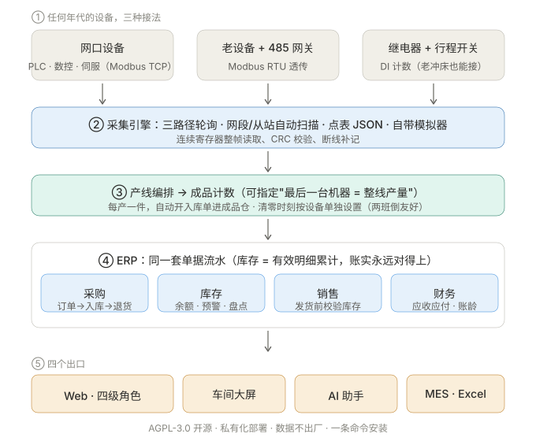

> Every arrow in that diagram is a runnable code path — simulators are included, so the whole loop
> works without any real hardware.

## See it working (no hardware required)

The portable and Docker builds **ship with demo data** (4 devices, energy curves, reports), so you
can click through immediately. For the full factory dataset (9 SKUs, 7 states each for purchase and
sales orders, 45 days of production history), clone the repo and run:

```bash
python tools/seed-demo.py    # seed a simulated factory
python tools/smoke-all.py    # 99 API smoke checks — all green means the install is healthy
```

| Production lines (devices by workstation) | Inventory (balances / alerts / movements) |
|---|---|
| 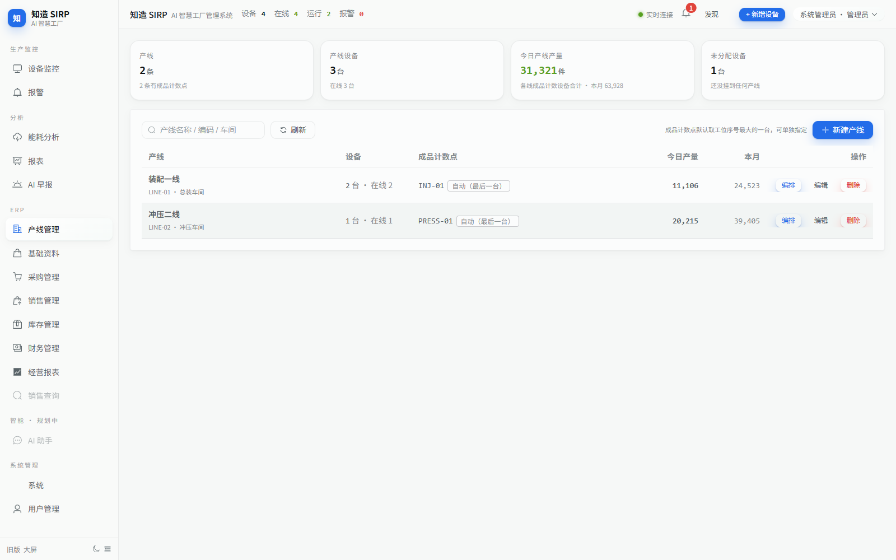 | 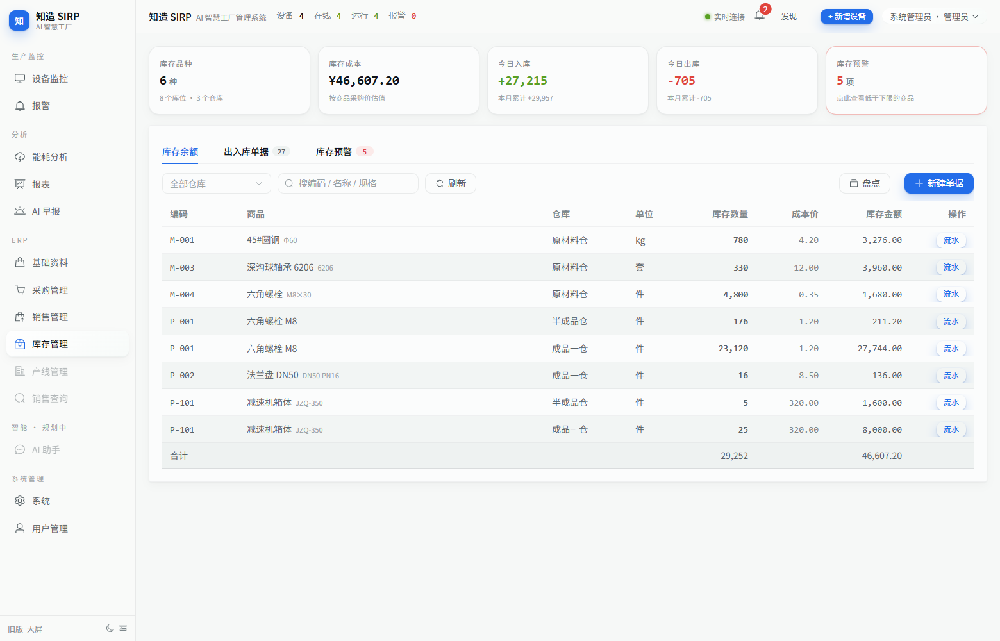 |
| **Finance (AR/AP, aging)** | **Business reports (stock movement, Excel export)** |
| 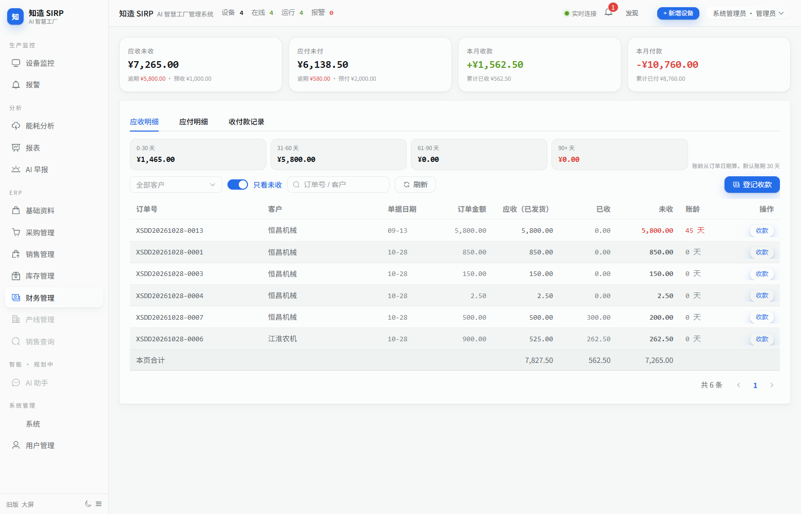 | 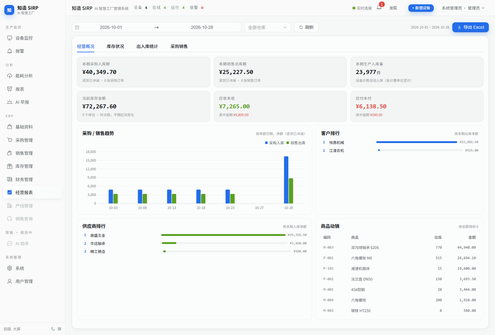 |
| **Machine output (day / month / year / all)** | **Stock documents (7 types, fully traceable)** |
| 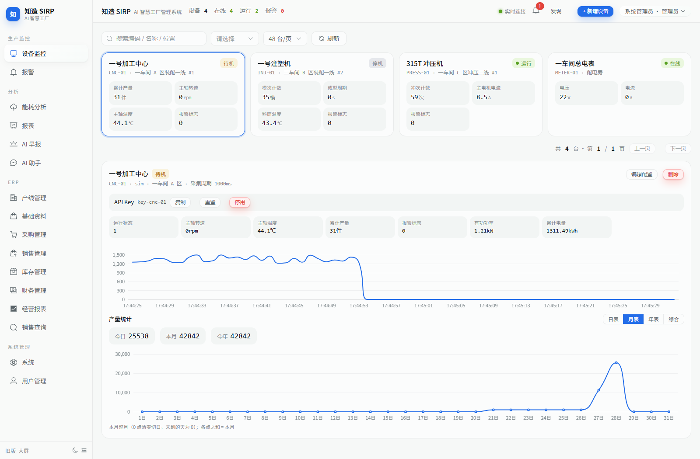 | 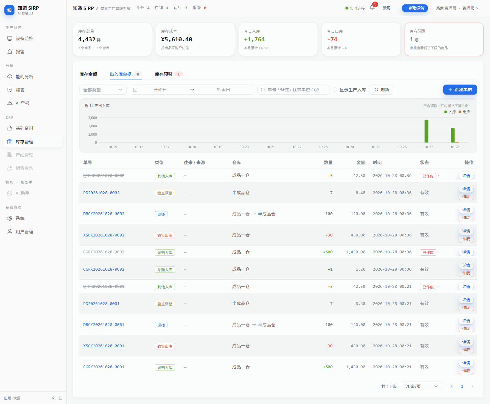 |
| **OEE (availability × performance × quality) with a 30-day trend** | |
| 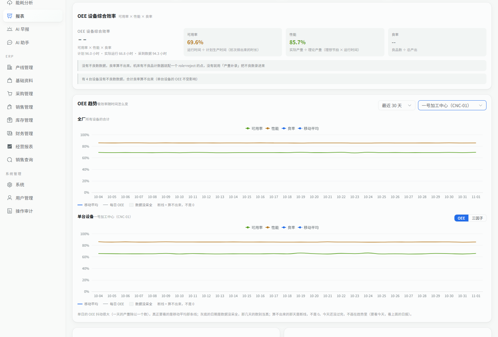 | |

## Real hardware, real screen

A bench photo beats a thousand architecture diagrams — a Siemens S7-200 SMART, one Ethernet
cable, zero PLC code changes:

| Workshop screen (live) | Production lines with the PLC online |
|---|---|
| 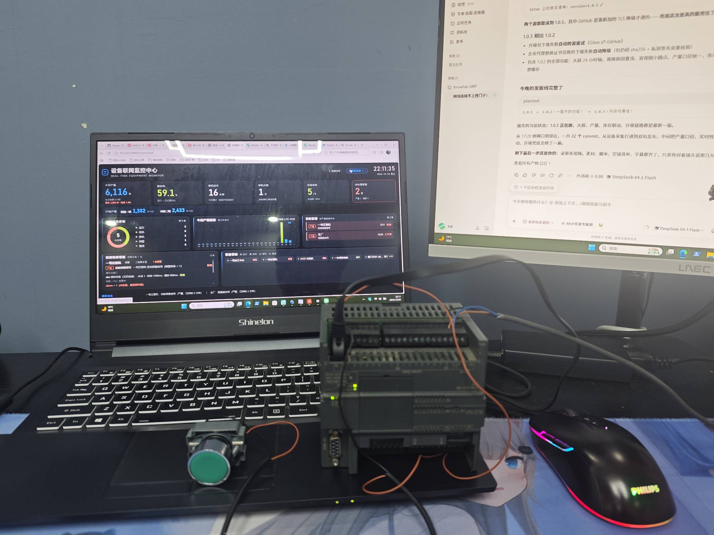 | 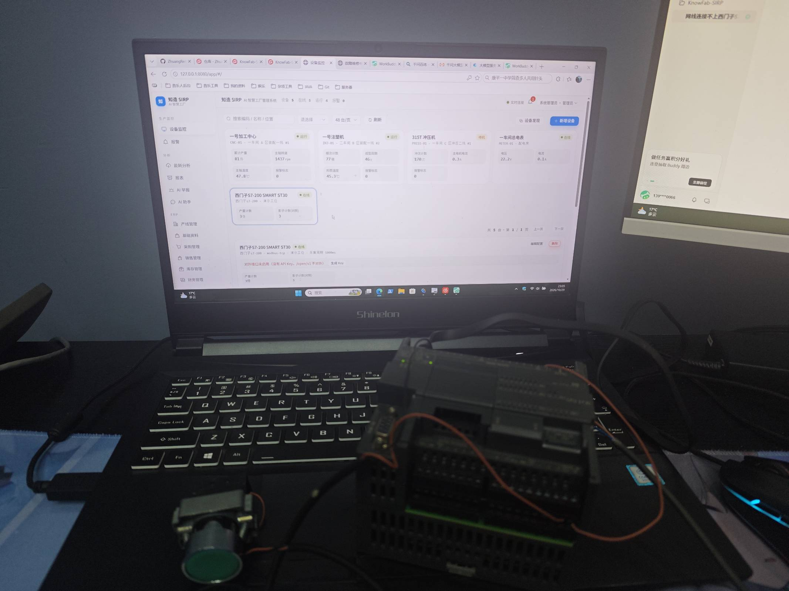 |

## Feature map

- **Device connectivity** — Modbus TCP / RTU / pass-through; subnet + slave-id double scan for
  discovery; point tables as JSON; relay + limit-switch counting (the old-press lifesaver); a
  built-in simulator so you can develop without hardware
- **Manual data entry** — network outages or missed meter readings can be filled in by hand
  (split per day, revocable). Reports show a separate "manual" line, never mixed with collected data.
- **Operation audit** — every configuration change (device, tariff, demand billing, shift plan,
  alarm rule, user, system setting, manual entry, app upgrade) leaves a trace: who, when, what.
  Append-only — nothing is edited or deleted, so what you read is what was recorded at the time.
- **Production** — per-machine counters (today / this month / this year); **four output charts**
  (day / month / year / all; integer axes, and the sum of the parts equals the KPI); production-line
  layout with workstation order and a designated finished-goods counting point; per-device reset
  hour (two-shift friendly)
- **ERP** — purchasing (order → receipt → return, progress derived from documents) · inventory
  (balances / 7 document types / alerts / stocktake) · sales (order → shipment → return, hard stock
  check before shipment) · finance (AR/AP, receipts and payments, four aging buckets) — inventory
  has exactly one algorithm (sum of valid movements), so the books always match the warehouse
- **Reports** — business overview / inventory movement (opening + in − out = closing) /
  inbound-outbound statistics / purchasing and sales execution, all exportable to Excel; documents
  carry a **business date**, so month-end back-filling never leaks into the wrong month
- **OEE** — availability × performance × quality, per device and plant-wide, with a 7/30/90-day
  trend and a moving average (one day swings on a single counter — the average is the trend).
  Standard capacity comes from a per-device **ideal cycle time**; the quality factor from a reject
  counter or a manual defect entry. A factor that cannot be computed is shown as "—" **with the
  reason** (no ideal cycle time? no defect data?) — never as a made-up number
- **Energy** — sub-metering, peak / flat / valley / super-peak tariffs, dual-track basic-charge vs.
  demand billing, 15-minute demand chart with a contract red line, and **national-standard
  energy-efficiency benchmarking** (GB25323-2023 limits) for green-factory filings
- **AI** — a daily briefing at 07:00 (optionally pushed to WeCom), plus an **AI assistant for the
  whole team**: ask about inventory / output / devices / orders / finance in natural language,
  scoped by role (sales can only ask about stock), implemented as tool calls rather than generated
  SQL, works with DeepSeek / Qwen / Ollama, and can be switched off entirely
- **Roles** — four levels: admin / plant manager / team lead / **sales** (read-only stock plus
  available-to-promise, no cost fields)
- **Delivery** — **self-contained portable build (bundled JRE + MariaDB, one command, Windows and
  Linux)**, one-click install script, Docker Compose, built-in database migrations, backup script,
  upgrades that only replace the jar; **zero-config auto-update** watches Gitee Releases by default
  (direct in China, GitHub as fallback) and lets the System page download, verify and install a new
  version in one click

## How it differs

| | KnowFab SIRP | jshERP | SaaS MES (e.g. KuaiGongDan) |
|---|---|---|---|
| Machine data | **protocol-level direct + legacy counting** | none | mostly barcode reporting |
| Production ↔ inventory | counting posts stock automatically, documents close the loop | manual documents | work-order driven |
| Getting started | **one command, bundled Java + database** (no Docker, no DB install) | bring your own JDK + MySQL | sign up, data lives in the cloud |
| Deployment | self-hosted, one command, data stays inside the plant | deploy it yourself | cloud SaaS |
| License | AGPL-3.0 + commercial | AGPL-3.0 | closed source |

## Why this project actually understands equipment

The author didn't imagine a factory and then write code. He spent 4.5 years as an electrician in
factories (non-standard automation), visiting machine builders of many brands, and only then moved
into full-stack development (2.5 years):

- **The relay + limit-switch counting path** comes from an electrician's everyday knowledge: which
  wire carries an auxiliary contact, how to tap a buzzer signal. Those are "how do I wire it on
  site" questions, not "how do I parse the protocol" questions.
- **Per-device reset hours and two-shift semantics** come from real handover habits on the line.
- **Aging buckets, demand billing and the stock-movement identity** come from the very plain
  pressure that "if the books don't match, the plant argues".

That is why the feature list contains almost no invented features — they all grew on the shop floor.
Device integration and retrofit questions are welcome by email.

## License

The code is open source under [AGPL-3.0](LICENSE): running it in your own factory, learning from it,
or forking it and keeping the fork open is **free**. Closed-source commercial use, SaaS or white
labelling requires a [commercial license](COMMERCIAL-LICENSE.md).

**Contact** — device integration, retrofit design, deployment, commercial licensing:
996491835@qq.com (please read the [handbook](docs/HANDBOOK.md) first; most answers are already
there).

## Backup & restore

> 客户 IT 最先问的两个问题：「数据怎么备份」「丢了怎么恢复」。这一节就是答案。

### 备份

```bash
./bin/backup.sh            # 保留 14 天（默认），输出到 backups/
./bin/backup.sh 30         # 保留 30 天
```

加进 crontab（每天 02:30）：

```bash
30 2 * * * /opt/device-hub/bin/backup.sh >> /opt/device-hub/logs/backup.log 2>&1
```

脚本会做三件事：`mysqldump --single-transaction` 导出 → **校验文件真的能用**（`gzip -t` + 检查 dump 收尾标记）→ 清理过期备份。

**校验不通过就不删旧备份**——顺序反了会变成「新备份是坏的，旧备份被删了，手里一份能用的都没有」。

### 恢复

```bash
# ① 先恢复到演练库，核对无误（推荐）
./bin/restore.sh backups/devicehub-20261104-023000.sql.gz devicehub_drill

# ② 确认无误，再覆盖生产库（会要求输入库名确认，并自动先备份现状）
./bin/restore.sh backups/devicehub-20261104-023000.sql.gz --force
```

它不会让你「手滑覆盖生产库」：

| 目标库状态 | 行为 |
|---|---|
| 不存在 / 空库 | 直接恢复（自动建库） |
| 已有数据 | **拒绝**，除非加 `--force`；加了也会先自动备份现状到 `backups/xxx-before-restore-*.sql.gz` |
| **就是生产库** | 同上，且**要求把库名敲一遍**（不是按回车） |

恢复完成后会核对**表数量**是否与备份文件一致——`mysql` 客户端在导入中途断掉时退出码不一定是非 0，光看「导入完成」会骗人。

> ⚠️ 别手工 `gunzip | mysql`：没有闸门、不验证、密码还会留在命令历史里。

### 演练记录

2026-11-04 在 MySQL 8.4 上真跑过一次完整演练（不是"脚本能跑"，是"数据真能回来"）：

| 检查项 | 结果 |
|---|---|
| 表数量 | 备份 3 张 → 恢复 3 张 |
| 行数 | 50 / 200 / 0，逐表一致 |
| 数据指纹（md5 聚合全表） | 两张表都与源库**完全相同** |
| 中文与特殊字符 `<>&"'` | 完好 |
| NULL 是否退化成空串 | 没有：16 个 `NULL` 仍是 `NULL` |
| 列注释 / 引擎 / 字符集 | 保留（InnoDB + utf8mb4_0900_ai_ci） |

演练还撞出一条真问题：MySQL 8 用**非 root 账号**跑 `mysqldump` 会报`Access denied; ... PROCESS privilege ... dump tablespaces`，但**退出码是 0、数据是完整的**——日志里天天出现 `Error:` 字样，运维要么被吓到、要么习惯性忽略（后者更糟）。
已加 `--no-tablespaces` 消掉它，并把 `mysqldump` 的 stderr 单独收起来检查：**报 Error 就算失败，哪怕退出码是 0**。

---
## Documentation

| Document | What is inside |
|---|---|
| [docs/README.en.md](docs/README.en.md) | English docs index: quickstart, deployment, device integration, API overview |
| [docs/HANDBOOK.md](docs/HANDBOOK.md) | Development and operations handbook *(Chinese)*: architecture, connecting real devices, adding protocols, deployment and upgrades, API list |
| [tools/portable/README-portable.txt](tools/portable/README-portable.txt) | Portable build guide *(Chinese)*: layout, ports, offline install, backup and migration |
| [docs/ip-inventory-template.xlsx](docs/ip-inventory-template.xlsx) | IP inventory workbook *(Chinese UI)*: auto-flags duplicate IPs and gateway clashes; pairs with the networking section in the handbook |
| [docs/ROADMAP.md](docs/ROADMAP.md) | Roadmap and full changelog *(Chinese; every entry carries measured results)* |
| [docs/COMPETITORS.md](docs/COMPETITORS.md) | Competitor comparison and talk tracks *(Chinese)* |
| [docs/DEMO.md](docs/DEMO.md) | Demo guide: seeding data and a recommended tour *(Chinese)* |
| [docs/RELEASE.md](docs/RELEASE.md) | Release process: tag → upload release assets → clients upgrade via *Check for updates* *(Chinese)* |
| [tools/verify-release.sh](tools/verify-release.sh) | Release verification *(shell)*: pushes the published package through the real customer upgrade path — signature check, migration on an old database, jar swap, tamper rejection, rollback — on a throwaway database, never on yours |

## Community (中文交流群)

Scan to join the QQ group — 设备接入、点表配置、部署踩坑都在里面聊：


**知造(KnowFab-SIRP) · QQ 群号 1132864448**

The group is Chinese-speaking. For English support, open an issue on GitHub/Gitee — both are watched.

---

## Contributing

Issues and pull requests are welcome. Before changing code, run `python tools/smoke-all.py` and
`python tools/selftest.py` and keep them green — the project's testing discipline is "for every
feature: seed → smoke → contract regression".

---

**Translations**: [English](README.md) *(canonical)* · [简体中文](README.zh-CN.md) *(full)* · [日本語](README.ja.md) · [한국어](README.ko.md) · [Español](README.es.md) · [Deutsch](README.de.md) · [Русский](README.ru.md) *(condensed)*.
Each condensed version covers the pitch, install commands and feature summary and links here
for details. Want another language? Open an issue or send a pull request.
