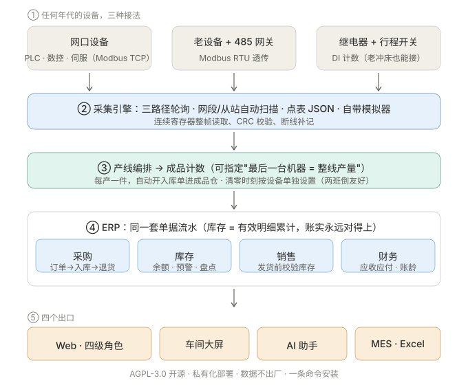
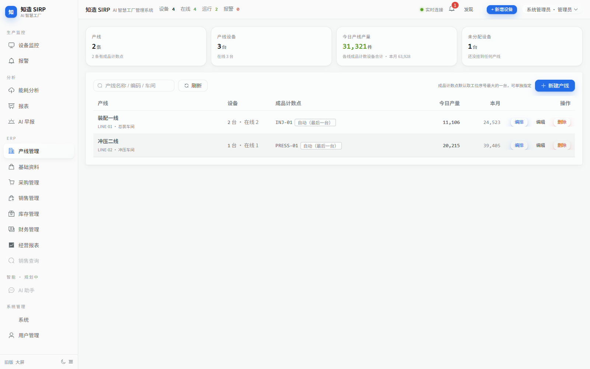
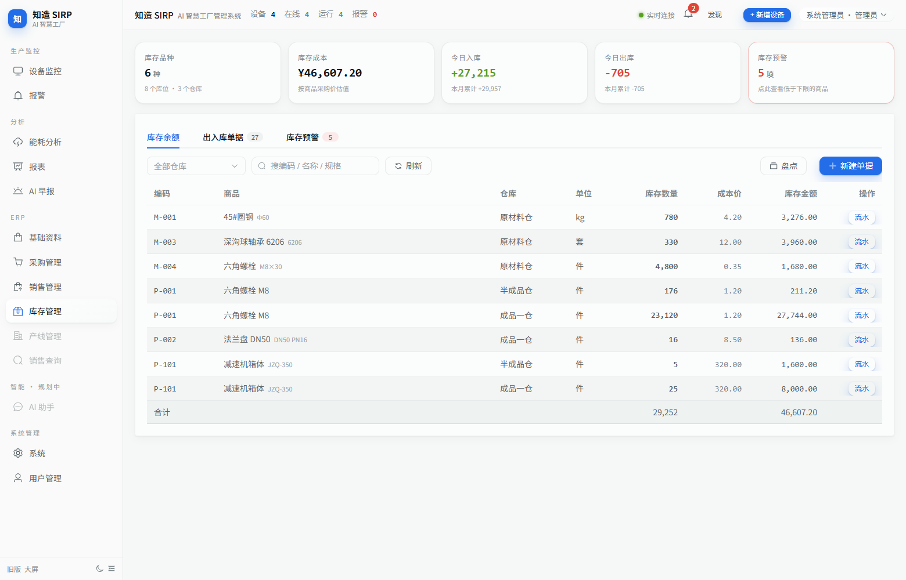
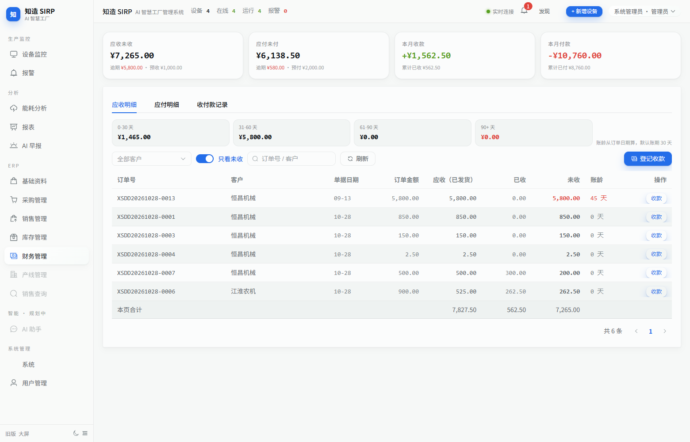
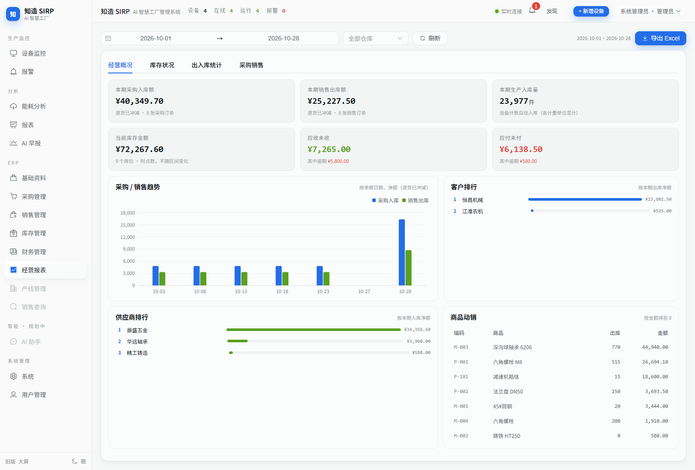
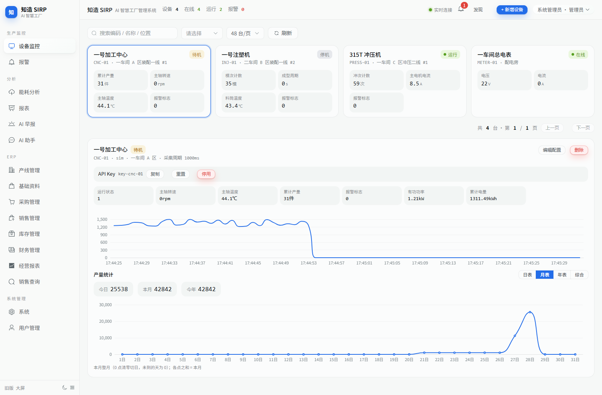
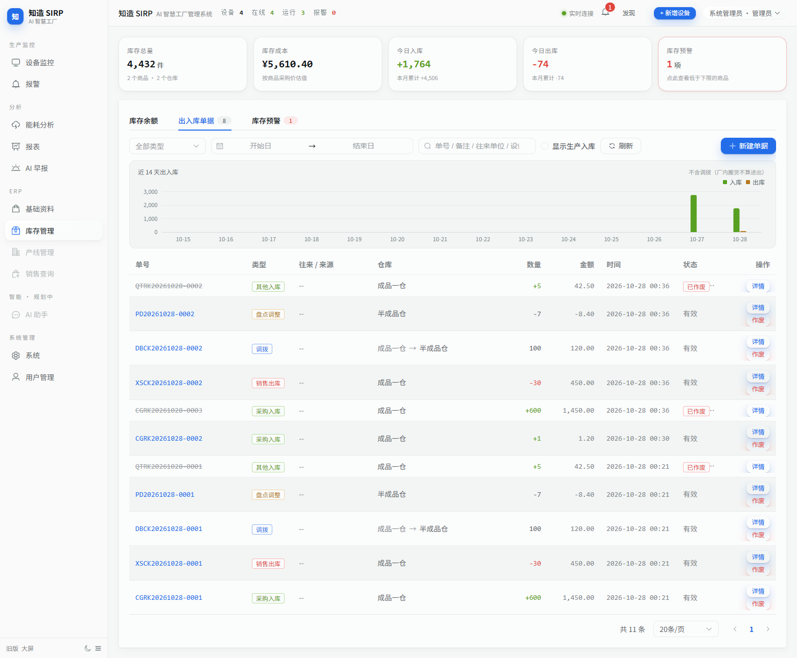

# 知造 SIRP · AI 智慧工厂管理系统

[English](README.md) · **简体中文** · [日本語](README.ja.md) · [한국어](README.ko.md) · [Español](README.es.md) · [Deutsch](README.de.md) · [Русский](README.ru.md)

**让机器自己报数，而不是让工人扫码。**
设备直连采集 → 产线成品计数 → 自动入成品仓 → 进销存/财务一体 → 经营报表 → 全员 AI 助手，
一套跑在**你自己服务器**上的系统。Java 17 + Spring Boot 3 + Vue 3 + MySQL，单 jar 交付；
也有**自带 Java 和数据库的便携版**——目标机器什么都不用装，一条命令就跑起来。

**四个硬特点**（都是车间现场逼出来的，不是功能清单凑数）：

- **一条命令装完，不用先装环境**：自带 Java 17 + MariaDB，Windows / Linux 各一行命令，
  不用 Docker、不用先装数据库，装完自动开浏览器；数据全在一个目录里，**拷走就是备份，删目录就是卸载**
- **老设备也能自动报数**：网口 Modbus TCP、485 透传、继电器 + 行程开关三种接法，
  没有网口的二十年老冲床，照样每产一件自动计一次
- **产量直接变成库存**：机器计数即入成品仓，不靠工人扫码；采购 / 库存 / 销售 / 财务共用一套流水账，
  "账实对不上"从根上不会发生
- **升级不搬数据**：系统页点「检查更新」→ 下载验签 → 只换 jar，数据库原地不动；
  私有化部署，数据不出厂

[AGPL-3.0 开源](LICENSE)（[商业授权](COMMERCIAL-LICENSE.md)） · [开发与运维手册](docs/HANDBOOK.md) · [路线图](docs/ROADMAP.md)

---

## 装起来：一条命令就够（也可以 Docker / 自带 MySQL）

三种装法任选一种。**推荐第 ① 种**：目标机器什么都不用装，一行命令，首次约 3~5 分钟
（要下 JRE 和数据库，之后秒起）；②③ 留给已经有服务器和数据库的场景。

### ① 零环境（推荐）：一条命令，不用装 Java / MySQL / Docker

**Windows**（Win10 及以上）：

```powershell
# 国内源（Gitee，推荐）
powershell -ExecutionPolicy Bypass -Command "irm https://gitee.com/ZhuangRenyang/KnowFab-SIRP/raw/main/tools/portable/install.ps1 | iex"

# 海外 / 备用源（GitHub）
powershell -ExecutionPolicy Bypass -Command "irm https://raw.githubusercontent.com/ZhuangRenyang/KnowFab-SIRP/main/tools/portable/install.ps1 | iex"
```

**Linux / macOS Intel**：

```bash
# 国内源（Gitee，推荐）
curl -fsSL https://gitee.com/ZhuangRenyang/KnowFab-SIRP/raw/main/tools/portable/install.sh | bash

# 海外 / 备用源（GitHub）
curl -fsSL https://raw.githubusercontent.com/ZhuangRenyang/KnowFab-SIRP/main/tools/portable/install.sh | bash
```

装完自动打开 `http://localhost:8080/app/`。**初始管理员密码在启动窗口打印**，同时写在 `data/initial-admin.txt`。

首次运行会自动下载 **JRE 17 + MariaDB 11.4 便携版**（约 130MB，走清华/阿里镜像），之后秒起：

| | |
|---|---|
| 数据库 | `127.0.0.1:3307`，独占端口，**不碰本机已有的 3306** |
| 数据在哪 | 全在安装目录内（`runtime/data`）——**卸载 = 删目录，拷走 = 备份** |
| 换端口 | `start.bat -Port 9000` / `PORT=9000 ./start.sh` |
| 停服务 | `stop.bat` / `./stop.sh` |

不想用命令行也行：到
[Gitee Releases](https://gitee.com/ZhuangRenyang/KnowFab-SIRP/releases) 或
[GitHub Releases](https://github.com/ZhuangRenyang/KnowFab-SIRP/releases) 下载
`device-hub-<版本>-portable.zip` → 解压 → Windows 双击 `start.bat`，Linux 执行 `./start.sh`。

> **完全离线**的车间电脑：在一台联网机器上跑一次（让它下完 `runtime/jre` 和 `runtime/mariadb`），
> 整个目录拷过去就能用，之后不再联网。
> 已经手动下好了 zip 的，也能让一键命令用本地包：
> `KNOWFAB_PORTABLE_URL=D:\下载\device-hub-1.0.1-portable.zip`（Windows 用 `set` 设同名环境变量）。
> 首次启动自带演示数据（4 台设备、能耗与报表曲线），不接真设备也能点着看。

> 安装脚本找包时**先问 Gitee、再问 GitHub**（两个源的包完全一致），哪个通走哪个；
> 装到哪也能改：`KNOWFAB_DIR`（Windows 默认 `%LOCALAPPDATA%\KnowFabSIRP`，Linux 默认 `~/KnowFabSIRP`）。

### ② Docker Compose（Linux 服务器，最省心）

```bash
git clone https://github.com/ZhuangRenyang/KnowFab-SIRP.git
cd KnowFab-SIRP
sudo bash deploy.sh        # 国内服务器：sudo bash deploy-cn.sh
```

脚本自动生成随机数据库密码 → 起容器 → 建库 → 打印访问地址和初始密码。

### ③ 已有 MySQL 8 和 Java 17 的机器

```bash
sudo bash install.sh --db-pass '你的MySQL密码'
```

装到 `/opt/device-hub` 并注册 systemd 服务；换端口 `sudo PORT=9000 ./install.sh ...`，
用 PostgreSQL 加 `--db pg`。也可以直接 `java -jar device-hub.jar` 裸跑
（数据库密码走 `DEVICEHUB_DB_PASSWORD`，或者起来后在系统页「数据库密码」里改）。

---

**不管哪种装法，装完第一件事**：打开 `http://<地址>:8080/app/` → 右上角**改掉初始密码**。

## 它解决什么问题

中小工厂想把产量、库存、能耗管起来，通常卡在三件事：

1. **老设备没有网口**——只有继电器和报警蜂鸣器，MES 厂商说"换 PLC 才能接"
2. **扫码报工靠人自觉**——工人忘扫、错扫，数据永远慢半拍
3. **设备数据和生产数据两张皮**——产量在车间，库存在表格，账永远对不上

知造 SIRP 的答法：**三种接入路径覆盖任何年代的设备**（网口直连 / 485 透传 / 继电器+行程开关计数），
机器每产一件自动进成品仓，采购-库存-销售-财务共用同一套流水账，数据不出你的机房。

| 适合你 | 不适合你 |
|---|---|
| 设备新旧混杂、想自动计数报产的工厂 | 需要工序级派工、计件工资的重流程 MES |
| 数据敏感、必须私有化部署 | 想要开箱即用不装软件的（用 SaaS 更省心） |
| 想要一套代码同时拿到设备数据 + ERP 账 | 只想要个看板（这个项目对你太重） |

### 一张图看懂数据怎么流



> 这张图里的每一条连线都是可运行的代码路径：模拟器自带，不接真设备也能走通全链路。

## 先看一眼效果（不用接真设备）

便携版和 Docker 版**首次启动已自带演示数据**（4 台设备、能耗曲线、报表），打开就能点。
想看完整的工厂演示数据（9 种商品、采购/销售各 7 种状态、45 天历史产量）——仓库克隆后跑：

```bash
python tools/seed-demo.py    # 灌一套仿真工厂数据
python tools/smoke-all.py    # 99 项全功能接口冒烟，全绿说明装得没问题
```

| 产线管理（设备按工位编排） | 库存管理（余额/预警/流水） |
|---|---|
|  |  |
| **财务管理（应收应付/账龄）** | **经营报表（进销存，可导出 Excel）** |
|  |  |
| **机台产量（日/月/年/综合四张表）** | **出入库单据（7 类，来源可溯）** |
|  |  |

## 功能全景

- **设备接入**：Modbus TCP/RTU/透传三路径；网段+从站双扫描发现设备；点表 JSON 化；
  继电器+行程开关也能计数（老冲床救星）；模拟器自带，无设备也能开发
- **生产**：机台计数（今日/本月/今年）、**日/月/年/综合四张产量图表**（纵轴整刻度，各表之和=KPI）；
  产线编排（工位序号、指定成品计数点）；清零时刻按设备单独设置（两班倒友好）
- **ERP**：采购（订单→入库→退货，进度从单据算）· 库存（余额/7 类单据/预警/盘点）·
  销售（订单→发货→退货，发货前硬校验库存）· 财务（应收应付/收付款/账龄四档）
  —— 库存只有唯一算法：有效明细累计，账实永远对得上
- **报表**：经营概况 / 库存进销存（期初+入-出=期末）/ 出入库统计 / 采购销售执行，全部可导出 Excel；
  单据带**业务日期**，月底补录不串月
- **能耗**：分项计量、峰谷平尖电价、基本电费+需量双轨测算、15 分钟需量图（超合同红线）
- **AI**：早报（每天 7:00 出，可推微信）；**全员 AI 助手**——自然语言查库存/产量/设备/订单/财务，
  按角色收口（销售只能问库存），工具调用而非生成 SQL，接 DeepSeek/通义/Ollama 均可，可整体关闭
- **角色**：管理员 / 车间主任 / 班组长 / **销售**（只读库存+可承诺量，无成本字段）四级权限
- **交付**：**免环境便携版（自带 JRE + MariaDB，一条命令装完即用，Windows/Linux 通用）**、
  一键安装脚本、Docker Compose、jar 内置数据库迁移、备份脚本、升级只换 jar 不动数据；
  **自动升级免配置**——默认盯 Gitee Releases（国内直连，失败兜底 GitHub），有新版本系统页直接提示、一键下载验签升级

## 和同类项目的差异

| | 知造 SIRP | jshERP | 快工单等 SaaS MES |
|---|---|---|---|
| 设备数据 | **协议级直连+老设备计数** | 无 | 扫码报工为主 |
| 生产↔库存 | 计数自动入库，单据闭环 | 手工单据 | 工单驱动 |
| 上手 | **一行命令，自带 Java + 数据库**（不用装 Docker/MySQL） | 需自备 JDK + MySQL | 注册即用，数据在云端 |
| 部署 | 私有化一键装，数据不出厂 | 需自行部署 | 云端 SaaS |
| 开源 | AGPL-3.0 + 商业双轨 | AGPL-3.0 | 不开源 |

## 为什么这个项目"懂设备"

作者不是先写代码再想象工厂——是先在工厂干了 4.5 年电工（非标自动化方向），
跑遍多个品牌机器的厂家现场，后来才转的全栈开发（2.5 年）：

- **继电器+行程开关计数这条路径**，来自电工本行的常识：哪根线有辅助触点、
  蜂鸣器信号怎么取，这些是"现场怎么接线"的问题，不是"协议怎么解析"的问题
- **清零时刻按设备单独设置、两班倒口径**，来自产线上真实的交接班习惯
- **账龄、需量、进销存恒等式**，来自"账对不上厂里是要吵架的"这种朴素压力

所以这个项目的功能清单里几乎没有"想象出来的功能"，全是现场长出来的。
设备接入、改造方案讨论欢迎邮件交流。

## 授权

代码以 [AGPL-3.0](LICENSE) 开源：自己工厂用、学习、二开并开源——**免费**；
闭源商用 / SaaS / 白标——需[商业授权](COMMERCIAL-LICENSE.md)。

**联系**：设备接入与改造方案讨论、部署实施、商业授权——
996491835@qq.com（发邮件前先看 [HANDBOOK](docs/HANDBOOK.md)，大部分答案在那里）。

## 文档

| 文档 | 内容 |
|---|---|
| [README.md](README.md) | 英文主 README（GitHub 默认展示） |
| [docs/README.en.md](docs/README.en.md) | 英文文档索引：安装、接设备、点表字段、接口概览 |
| [docs/HANDBOOK.md](docs/HANDBOOK.md) | 开发与运维手册：骨架设计、接真设备、加协议、部署升级、接口清单 |
| [tools/portable/README-portable.txt](tools/portable/README-portable.txt) | 便携版说明：目录结构、换端口、离线部署、备份与迁移 |
| [docs/ROADMAP.md](docs/ROADMAP.md) | 路线图与完整变更记录（每条功能都带实测数据） |
| [docs/COMPETITORS.md](docs/COMPETITORS.md) | 竞品对比与话术 |
| [docs/DEMO.md](docs/DEMO.md) | 演示指南：一键灌数据 + 推荐巡览路径 |
| [docs/RELEASE.md](docs/RELEASE.md) | 发版流程：打 tag 传 Release，客户机点一下"检查更新"即可升级 |

## 参与贡献

Issue / PR 都欢迎。改代码前先跑 `python tools/smoke-all.py` 与 `python tools/selftest.py`，
提交时保持全绿——这个项目的测试纪律是"每完成一个功能：播种 → 冒烟 → 契约回归"。
