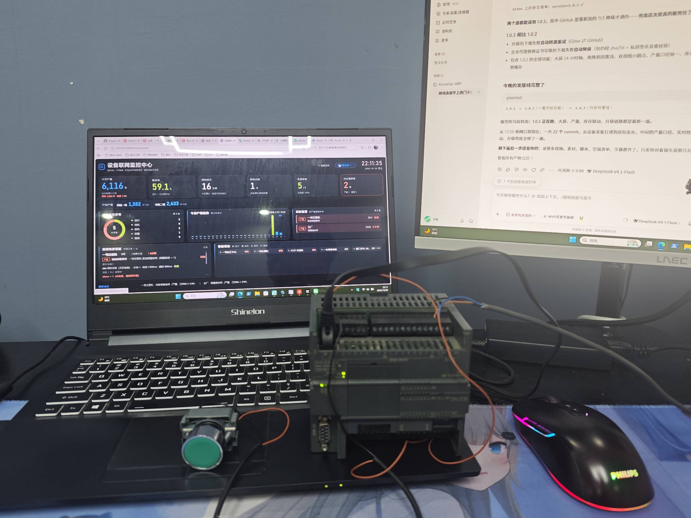
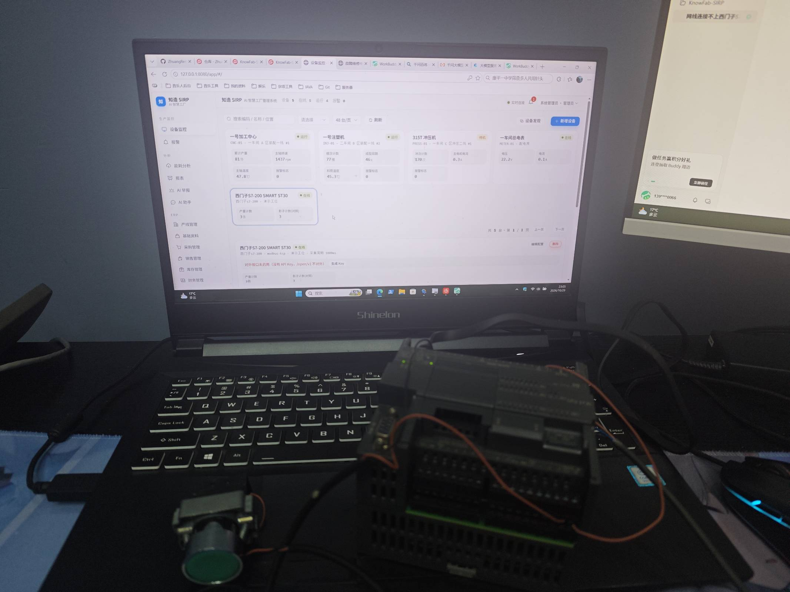

# CSDN 文章草稿（技术向，2026-11-01）

> 发 CSDN / 掘金 / 开源中国 可共用这篇（标题微调）。
> CSDN 创作中心的多平台分发可用，但知乎/公众号请改标题和开头后再同步。
> 语调：技术分享 + 顺便开源，不许写成广告文。

---

## 标题

```
开源了一套工厂数据系统：Java + Vue，不改一行 PLC 程序，把老设备接进 ERP
```

备选（掘金/开源中国）：
- 《从 Modbus 采集到 ERP 单据：一个人写的开源工厂数据系统，讲讲技术方案》
- 《寄存器不清零怎么算产量？——开源设备数据系统的几个关键设计》

## 正文

### 为什么做这个

中小工厂上 MES/数字化，普遍卡在三件事：贵的用不起、便宜的不好用、老设备不联网。
车间的 CNC、注塑机、电表，很多只有 485 口或者一个 Modbus 从站，
厂里没有 IT 部门，装个系统还要装数据库、配 Docker，基本就劝退了。

我把它做成了一个安装包：自带数据库，一条命令装完，浏览器打开就能用。
项目叫「知造 KnowFab-SIRP」，AGPL-3.0 开源，本文讲讲几个关键设计。



> 实拍：一台 S7-200 SMART，一根网线，没改一行 PLC 程序——
> 左边笔记本跑的就是系统本体，车间大屏 + 产量实时跳动。

### 一、采集层：全程只读 + 增量算产量

采集只读，只用 Modbus 功能码 3（读保持寄存器）和 2（读离散输入），
不写寄存器、不下发指令——这一点是电工敢往产线上接的前提。
远程控制是独立的可选项，点位级授权，默认全关，每次下发记审计日志。

产量怎么算？PLC 的产量计数器寄存器里已经有几十万，而且永远不清零：
- 接入那一刻的值只做基准，之后每 +1 记 1 件（增量法）；
- 计数器中途归零（断电重启）识别为「重置」，差值取负时丢弃，不会算出负产量；
- 影子寄存器（对照点）用于验证倍率是否配对。

采集调度按设备独立轮询（500ms~5s 可配），单设备超时不影响其他设备，
掉线判定带连续失败次数阈值，避免网络抖动误报离线。

### 二、告警引擎：离线 / 停机 / 报警位 / 数值越限

四类规则覆盖不用改 PLC 程序的场景：
- OFFLINE：读不到数据
- STOP：状态点等于指定值（一般填 0）
- FLAG：任意标记为 alarm 的点位不为 0
- THRESHOLD：某点位 op 阈值（>、≥、<、≤、=、≠）

工程上真正难的不是触发，是别误报：
- **持续时间（forSeconds）**：条件连续成立 N 秒才算告警，滤抖动；
- **恢复确认（recoverSeconds）**：条件消失后再观察 N 秒才判恢复，防临界值反复横跳；
- **冷却时间（cooldownSeconds）**：恢复后 N 秒内不重复报同一台；
- **生效时段 / 生效星期**：夜班不报"整厂停机"。

消息模板支持 {device}/{code}/{value}/{threshold}/{duration}/{point} 变量，
推企业微信机器人、钉钉、飞书、ServerChan，免打扰时段内只推严重级。

### 三、交付形态：一个安装包，内置数据库

客户机器上最怕装环境。打包方案：
- 后端单 jar（Spring Boot 3 + JPA），启动即自动建表；
- 内置 MariaDB 11.4（MySQL 兼容），安装包一起装好，零配置；
- Windows 一条 PowerShell 命令安装，Linux 一条 curl；
- 升级走「检查更新」接口，主源 Gitee、备用源 GitHub 自动切换（跨源兜底）；
- 断网可用，数据不出厂——这是很多工厂的硬性要求。

安装命令（复制即用）：

Windows（PowerShell，管理员）：
```powershell
irm https://gitee.com/ZhuangRenyang/KnowFab-SIRP/raw/main/tools/portable/install.ps1 | iex
```

Linux / macOS：
```bash
curl -fsSL https://gitee.com/ZhuangRenyang/KnowFab-SIRP/raw/main/tools/portable/install.sh | bash
```

装完浏览器打开 http://localhost:8080 ，默认账号 admin / 123456（记得改密码）。

### 四、前端：Vue 3 + 独立车间大屏

管理端 Vue 3 + Element Plus + ECharts（按需注册，深浅主题跟随 CSS 变量），
中英双语（vue-i18n）。
车间大屏是独立静态页：零外部依赖、零构建工具，引 CDN 会白屏的地方直接就是
一个 HTML——柱状图/SVG 环形图全部手写，5 秒拉一次快照接口，断网保留最后一屏数据。

### 五、ERP 部分

采集到的东西要落到经营，不然只是个看板：
产量自动进库存、自动开生产入库单（点位绑定成品 + 计数联动），
采购 / 销售 / 库存 / 应收应付 / 账龄 / 经营报表一条链，
对外走 /open/v1/** + API Key，能和客户现有 ERP 对接。



> 实拍：西门子 S7-200 SMART 接入后，自动出现在产线看板——
> 产量、状态、报警、电耗同屏，采集和 ERP 是一条链。

### 结尾

- 仓库：https://github.com/ZhuangRenyang/KnowFab-SIRP （Gitee 同名，国内快）
- 协议 AGPL-3.0，闭源商用另有商业授权
- 交流群 1132864448，接入问题带设备型号 + PLC 的 IP 来问

觉得有用的话点个 star，这对独立开发者真的重要；有设备想接但不会配的，
评论区发型号，我直接告诉你寄存器怎么配。
